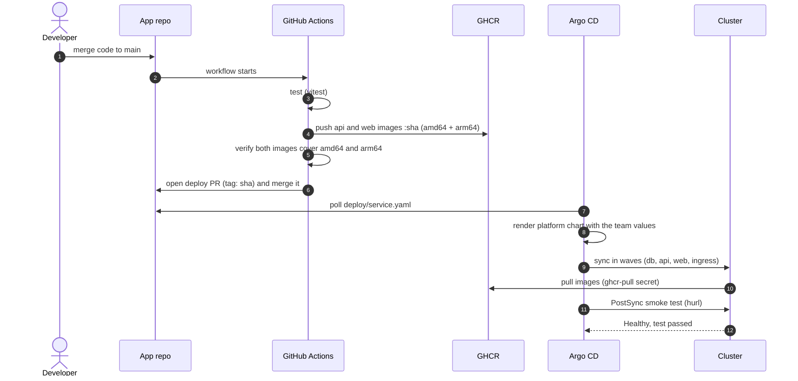
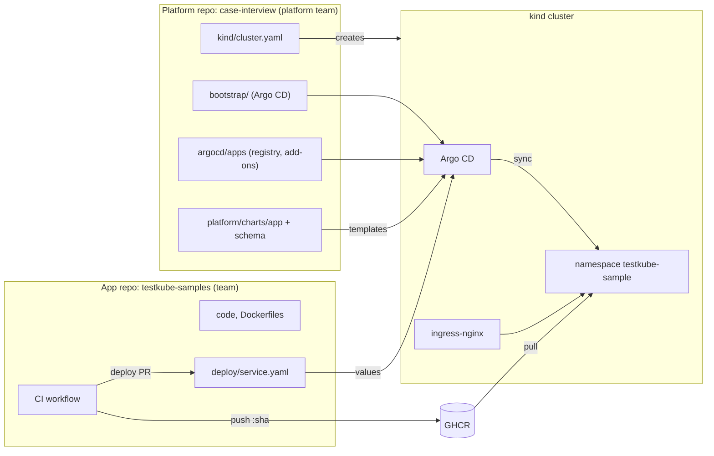
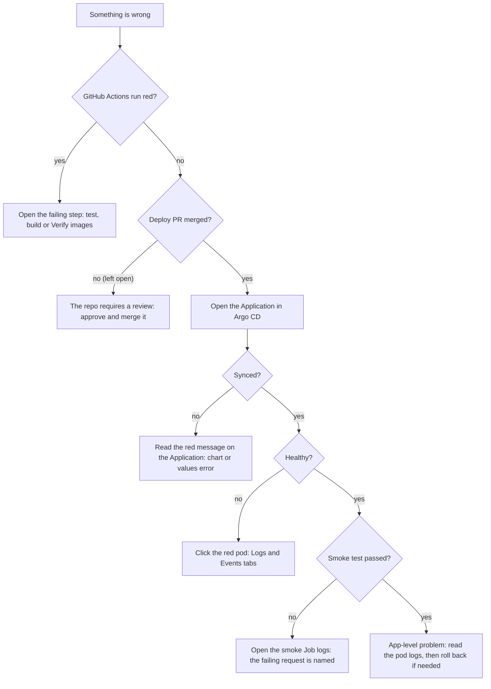
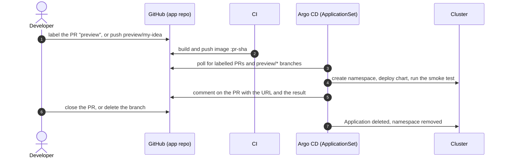
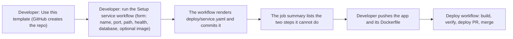
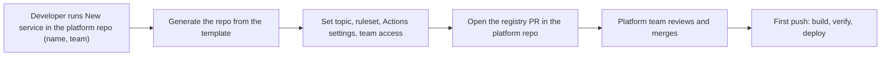

# Design: a golden path for deploying testkube-samples

Platform engineering case study -- Francesco Nassano

## Status at a glance

This is the reference document. For the story read `presentation.html` or `walkthrough.md` first; this file
holds the reasoning, the numbers and the options behind them.

| | |
|---|---|
| **Scoped as the MVP** | The cluster as a manifest, Argo CD behind an ingress, the golden-path chart with its schema and guardrails, a pipeline that builds, verifies and releases through a pull request, a smoke test, a rollback procedure, and a template with a setup form. All of it runs today |
| **Thought through, not built** | Preview environments, secrets, per-service cloud permissions, admission policy, canary releases, a staging, and automatic registration of new services (sections 4 and 6) |
| **What is proven** | End to end on a local kind cluster: CI to GHCR, deploy PR, Argo CD sync, app reachable, smoke test passed. Running it found real bugs that static checks missed: the web pods crashed because the image wrote to a root-owned folder while the pod runs as a normal user (checking `id` is not the same as running as that user) |
| **What is missing, by importance** | 1. Credentials are a personal token copied into the cluster (4.1). 2. A bad release reaches every user until someone reverts it: a canary would limit that, and it needs metrics that do not exist yet (4.7). 3. Every platform change reaches every service at once, because services always use the newest chart on `main`, and all services share one Argo CD project (4.6). 4. No secret store and no cloud permissions per service (4.2, 4.3). 5. Rollback, self-healing and a failed release are documented but not demonstrated, and so is NetworkPolicy enforcement on kind (runbook, "Demos"). 6. Previews are described one service at a time; testing several services together is an open question (4.8) |
| **What I would do next** | Pin the chart per service and add an AppProject per team; explore preview environments, Image Updater, Kyverno and External Secrets in a shared non-production cluster (section 5) |

Status tags used in this document and in the others:

| Tag | Meaning |
|---|---|
| **Works today** | Runs on a local kind cluster and was verified |
| **Planned** | Specified here, not built |
| **To explore** | Needs a spike before we commit |

---

## Assumptions

The brief says to mark assumptions. Most of ours are implicit in the brief; they are written down here so
nobody has to guess. Each row says what breaks if it is wrong.

| # | Assumption | Why it is reasonable | If it is wrong |
|---|---|---|---|
| A1 | Kubernetes is mandated | The brief says the team "needs to deploy to Kubernetes" | A managed PaaS may serve a three-tier app and a team new to Kubernetes better. Worth raising with the stakeholders; the platform contract (`service.yaml`) would survive the move |
| A2 | The real target is a managed cluster (for example EKS); kind is a stand-in | The brief suggests kind or minikube | Load balancers, storage classes, IAM and TLS differ. These are listed in 4.2 and 4.10 |
| A3 | GitHub hosts the code and runs CI; GHCR holds images | The upstream repo is on GitHub | The workflow files change; the model (CI builds, a PR deploys, Git is the source of truth) does not |
| A4 | The first users are one pilot team with services like the sample: stateless HTTP plus one database | The sample is three-tier | Other shapes (workers, cron jobs, streaming) need the escape hatch (4.10) |
| A5 | Every service has a Dockerfile, listens on one HTTP port and has a health path | True for the sample | The template repository (4.9) would carry the minimum contract |
| A6 | The database is Postgres, one per service. Here it runs in the cluster, as the sample app does; in production it would be a managed database (or run by an operator), because a database in the cluster needs backups, upgrades, storage and failover care. **The app creates its schema and minimum data on first boot** | True here: the sample runs only `SELECT` and needs no schema | With two replicas, two instances can migrate at once (use an advisory lock or a one-off migration Job). A rollback must keep working with the new schema (add first, remove later) |
| A7 | Platform and product teams have separate concerns. Product teams own **what** runs (the code and `deploy/service.yaml`); the platform owns **how** it runs (the chart, the guardrails, the cluster). The contract between them is stable, so the platform can improve in steps without product teams noticing | Each side can change at its own pace | If the contract leaks (a team has to know how the chart works), the platform becomes a bottleneck. The contract is `deploy/service.yaml` plus the pull request flow; changes to it are versioned. Everything behind it (chart, Argo CD, add-ons) may change freely |
| A8 | Security and robustness come later, not never | The brief values thinking over completeness | The baseline in 3.4 is already in (non-root, quotas, network policies, no secrets in Git). Deferred, with a plan in 4.1 to 4.4: secret store, scanning, signing, policy engine, backups |
| A9 | Developers have GitHub and a browser, and do not have `kubectl` | That is the premise of the brief | Diagnosis must work in GitHub and Argo CD (3.3) |
| A10 | One environment in the MVP; previews are to be explored and a staging is not planned (it is a later option) | Four hours | See 4.8 |
| A11 | A platform team exists and owns the chart, the registry and support | The brief casts us as the platform engineer | Without an owner the chart rots; section 5 and the adoption plan assume one |
| A12 | Everything is defined in Git (infrastructure and configuration as code). Argo CD and the pull request flow follow from it | Every change is reviewed, traceable and revertable, and developers generally prefer that to a console | A console that changes things directly would be quicker to start and would leave no review and no easy revert |

The one deliberate exception to "no secrets in Git": the demo database password in the chart.

---

## 1. Critical analysis of the requirements

The brief has three sentences of requirements. Each one hides a decision.

| # | Requirement | What it really means | Design answer | Cost / risk |
|---|---|---|---|---|
| 1 | "The team ... are not familiar with [Kubernetes]" | The adoption surface is the product. Success = number of Kubernetes concepts a developer must learn. Target: zero. | One file per service. The platform chart renders everything else. | The chart becomes a product: owner, versions, escape hatch. |
| 2 | "create the required deployment tooling" | Deploy is a pipeline, not a command: repeatable, auditable, reversible. | CI builds and never deploys. A deploy is a PR that changes image tags. Argo CD pulls. | Two moving parts and a PR per release. |
| 3 | "crafting a great developers' experience" | Fast feedback; failures visible where the developer looks. | PostSync smoke test per release, PR image builds, same Dockerfiles for compose and cluster. | Smoke tests only cover what the team lists. |
| 4 | "all their work is available at ..." (implicit) | The app was not written for Kubernetes. Some defects are not deployment problems. | Fix the app where the defect is, as a visible commit in the app repo. | We carry a copy of upstream (6.2). |

The requirement that decides the outcome is **#1**. The rest of the design follows from it.

---

## 2. What the repo looked like (facts, not opinions)

Three tiers: React/Vite (web, 4173), Node/Express (api, 8080), Postgres. Tests exist (`vitest`, `hurl`,
Cypress) but run against an app that is already up.

| # | Defect | Evidence | Effect |
|---|---|---|---|
| 1 | Image `ttl.sh/wito-hello-app:1h` | `apps/api/k8s/deployment.yml` | Third-party image, 1 hour TTL. Any deploy is broken by construction. |
| 2 | No `DB_HOST` / `DB_PORT` in the Pod | same file; the api defaults to `localhost:15432` | `/hello-pg` always fails. |
| 3 | Ingress backend `demo` | `apps/api/k8s/ingress.yml` | The Service is called `hello-app`. |
| 4 | `API_ORIGIN = "http://localhost:8080"` | `apps/web/src/App.tsx` | The browser runs the code, so `localhost` is the visitor's machine. Never works behind an ingress. |

Defect 4 is not a Kubernetes problem. No manifest can fix it. The fix is a build-time `VITE_API_BASE`
(default `/api`), kept as a commit on top of upstream `a21ed43`.

### 2.1 Platform fixes versus findings for the app team

I cannot tell whether the weaknesses of the sample are deliberate or oversights, and the design does not
depend on it. Either way a platform engineer sorts them into what the platform absorbs and what goes back to
the team.

| Finding | Platform response | Goes back to the app team |
|---|---|---|
| API URL hardcoded as `http://localhost:8080` in the web app | Build-time `VITE_API_BASE`, default `/api`, one host behind the ingress | Make the API base configurable, or default to same-origin |
| `apps/api/k8s/*` broken (expired `ttl.sh` image, no DB variables, wrong Ingress backend) | Removed; the chart replaces them | Delete stale sample manifests; they were left over from a local-Kubernetes blog demo |
| Images run as root; `vite preview` writes next to its config | Platform requires non-root; `chown` of one directory and `USER node` | Images must work as a normal user: a platform requirement |
| `node:lts` is a floating tag and a full image | `node:lts-slim` (api 1.8 GB to 510 MB) | Pin the version; use a multi-stage build |
| `vite preview` serves production traffic and needs all of `node_modules` (web image 1.4 GB) | Not changed; the production answer is a multi-stage build | Serve static files with a small web server (about 50 MB) |
| DB user, password and name hardcoded in `index.mjs`; only host and port are configurable | Chart sets the same demo values | **Security finding:** read all connection settings from the environment so each environment has its own secret |
| No health endpoint; readiness cannot check the database | `/hello` as probe, `/hello-pg` in the smoke test | Add `/healthz` and a readiness check |
| A new database connection per request, no pool; CORS open to all origins | Not changed | Pool connections; restrict CORS |

The platform fixed what it needed in order to deploy the application safely. The remaining findings belong to the
application's team.

---

## 3. The workflow

**Status: Works today.** Verified end to end on kind.

Where things live:

What a developer does:

| Task | Developer action | Kubernetes concepts needed |
|---|---|---|
| Ship a code change | Open a PR (CI tests and builds, no push), merge it; CI then verifies, opens and merges the deploy PR | 0 |
| Change a port, path or env var | Edit `deploy/service.yaml` | 0 |
| Add a service | `deploy/service.yaml` in the app repo, plus one list entry in the platform repo registry | 0 |
| See why a release failed | Open Argo CD, read the smoke test log | 1 (a failed Job) |
| Roll back | Click **Revert** on the deploy PR and merge it (runbook, "Rollback") | 0 |

You do not need to write Deployments, Services, Ingress, NetworkPolicies, quotas or probes.

### 3.1 What "great developer experience" means here

Three promises, each one measurable:

| Promise | Meaning | Measure |
|---|---|---|
| **Fast first deploy** | A developer with a Dockerized app reaches a live URL without help | **Time to first deploy** (the KPI) |
| **Low cognitive load** | Shipping needs no Kubernetes concepts: one file, five words (service, component, path, tag, smoke test) | Concepts needed to ship (target 0) and to diagnose (target 1: "a pod failed") |
| **Self-service diagnosis** | When something is wrong, the developer finds out what, where and what to do, in tools they already use | Support requests per service per month |

The numbers to watch (DORA's four keys, plus two for onboarding):

| Metric | Definition | Target | How it is measured | Today |
|---|---|---|---|---|
| **Time to first deploy (KPI)** | A new engineer clones the template, names the app, pushes the code, and the service answers on its URL. **Wall-clock**, pipeline wait included; **hands-on** time (the engineer's own work, wait excluded) is reported next to it | **30 minutes** wall-clock; hands-on **under 10 minutes**. The numbers are chosen to be plausible for a newcomer, not derived: what matters is that both are measured and the wait is visible | Repo `created_at` to the first successful smoke test; hands-on from three timed runs with people who do not know the platform (median) | Not yet measured: the template repository exists (4.9), but nobody who does not know the platform has timed it. The pipeline part is measured in 3.2 |
| Lead time for change | Code merged to the new version serving traffic | 8 minutes | App PR `merged_at` to the Argo CD sync `finishedAt` | **11.1 minutes measured** on one run from `main` with a cold web build (see 3.2) |
| Change failure rate | Share of deploys that are rolled back or fail the smoke test | Under 15% | Revert PRs and failed PostSync hooks, per month | No data yet |
| Time to restore | Revert PR opened to Application Healthy | 10 minutes | Revert PR `created_at` to Argo CD `finishedAt` | Not measured; procedure exists (runbook, Rollback) |
| Deployment frequency | Deploys per service per week | Rising | Merged `chore(deploy)` PRs | No data yet |
| Manual steps to onboard | Actions a developer takes by hand | 1 (the New service request) | Count in the runbook | 6 by hand (repository, form, two settings, push, registration pull request, pull secret) |

### 3.2 Time to first deploy: measured and projected

The KPI is split on purpose. The engineer's **hands-on time** is what the platform controls through its design
(template, one file, no Kubernetes). The **wait** (build, Argo CD, image pull) is mostly compute and can be
tuned separately. Reporting one number would hide which of the two moved.

| Step | Kind | Today | Basis | Lever to reduce it |
|---|---|---|---|---|
| 1. Create the repository from the template | Hands-on | about 0.5 min (the template exists) | Estimate | Template repository plus a self-service workflow (4.9) |
| 2. Run the Setup service form (name, port, path, health, database) | Hands-on | 1 min | Estimate | Editor autocomplete from the schema (4.10) |
| 3. Apply the two printed steps (repository settings, registry entry) and push the code | Hands-on | 3 to 4 min | Estimate | Self-service repository creation (4.9, Level 2) |
| 4. CI: test and build both images (multi-arch) | Wait | **3.2 min** warm cache; **7.2 min** on the run from `main` (web build 6.2 min, cold cache); 8.1 min on the first cold run | Measured: warm run test 33 s, api 57 s, web 2 min 11 s; run from `main` test 29 s, api 117 s, web 371 s | Layer cache, a static web image (multi-stage), native arm64 runners |
| 5. Verify, open and merge the deploy PR | Wait | **29 s** | Measured: the deploy job (login, verification, PR, merge) | |
| 6. Argo CD notices the change | Wait | **175 s** | Measured: deploy PR merged to sync started (default polling interval) | A webhook from GitHub (immediate) |
| 7. Sync, pull images, start pods, smoke test | Wait | **59 s** | Measured: sync started to finished, including the smoke test and new image layers | Static web image (about 50 MB) |
| 8. Smoke test | Wait | included in step 7 | hurl ran 3 requests in under 1 s | |

| | Today | After the levers |
|---|---|---|
| **Hands-on** (steps 1 to 3) | about 5 min (estimate, not yet timed) | about 2 min with Level 2 |
| **Wait** (steps 4 to 8) | **about 11 min measured** (CI 7.2, polling 2.9, rollout and smoke test 1.0); 3 to 4 min with a warm cache | about 3 min |
| **Wall-clock total** | **about 16 min** (pipeline measured at 11.1 min from push to verified, plus about 5 min hands-on) | about 5 min |

Reading it: against a 30-minute target the current pipeline already fits with a wide margin, so the levers
are optimisations, not requirements. The template repository now exists, but nobody who does not know the platform has timed it yet. Time three runs by people who do not know the
platform and report the median of each number.

### 3.3 When something goes wrong (Day 2)

A developer without Kubernetes experience must be able to answer three questions: **what failed, where, and
what do I do?** The answer is in tools they already use: GitHub (pipeline and PRs) and the Argo CD UI
(`argocd.localhost:8088` here). No `kubectl`.

The failure signatures (what you see, likely cause, what to do) and the Argo CD statuses are in `docs/runbook.md`, "When a deploy is red".

What each step needs to exist, and its status:

| Capability | Status |
|---|---|
| GitHub Actions logs and the deploy PR comment (previous tag, link, rollback steps) | **Works today** |
| Argo CD UI with pod **Logs** and **Events** | **Works today** (admin user only) |
| Read-only developer role in Argo CD (permissions `get` on applications and `logs`), so developers can look but not change | **Planned** |
| Logs that survive a crashed pod, searchable (Loki, CloudWatch or your logging product) | **Planned**: pod logs vanish with the pod |
| Alert to the team's channel on Degraded or a failed sync (Argo CD Notifications) | **Planned** |
| Golden-signal dashboard per service (request rate, errors, latency; ingress-nginx metrics need no app code) | **Planned**; also the input for canaries (4.7) |
| One-page "my deploy is red" guide (`docs/runbook.md`) linked from the PR comment | **Works today**; the link appears once the `PLATFORM_DOCS_URL` repository variable is set (it is not set today) |

### 3.4 What the platform enforces

**Status: Works today.** The chart applies these; the team does not request them and cannot override them (`platform/charts/app/templates/_platform.tpl`, `values.schema.json`).

| Guardrail | Effect |
|---|---|
| Pod Security Admission `baseline` (warn `restricted`) | Blocks privileged pods |
| ResourceQuota | One team cannot take the cluster |
| LimitRange | A container without resources gets defaults |
| NetworkPolicy default-deny (ingress) plus explicit allows | Pods are unreachable unless the chart allows it, on a cluster whose network plugin enforces policies (not verified on kind). Outgoing traffic is not restricted |
| Security context | Non-root (uid 1000), no privilege escalation, all capabilities dropped |
| PodDisruptionBudget (`maxUnavailable: 1`, components with 2 or more replicas) | Node drains and upgrades evict one pod at a time, so the service keeps answering |

Sync waves: `-10` namespace, `-5` guardrails, `10` db, `20` api, `30` web, `40` ingress, then PostSync.

---

## 4. From MVP to a real scenario

The MVP takes shortcuts on purpose. This section lists each one, what replaces it, and where to
learn more before committing.

### 4.0 The map

| Area | MVP today | Real scenario | Tools | Track |
|---|---|---|---|---|
| CI and repo credentials | `gh` OAuth token copied into the cluster; `GITHUB_TOKEN` opens PRs | Narrow, per-purpose identities | GitHub App, deploy keys, GitHub OIDC | **Planned** (4.1) |
| AWS identity | None (kind has no IAM) | One IAM role per service, no static keys | EKS Pod Identity or IRSA, permissions boundary, Terraform or Crossplane | **Planned** (4.2) |
| Secrets | Demo password in the chart; pull secret created by a script | Secrets in a store, synced into the cluster | External Secrets Operator + AWS Secrets Manager or OpenBao | **To explore** (4.3) |
| Admission policy | Chart constants and the values schema | A second layer at admission time | Kyverno | **To explore** (4.4) |
| Releasing | CI verifies images, opens a deploy PR and merges it; one environment | Automatic for dev, gated for prod | Image Updater, Kargo | **Works today** (auto-merge, run once); **To explore** the rest (4.5) |
| Chart versions and tenancy | Chart from `main`; one `default` AppProject | Pinned chart per service; AppProject per team | Git tags or OCI chart, AppProject | **Planned** (4.6) |
| Progressive delivery | Rolling update | Canary with automatic analysis | Argo Rollouts, Prometheus | **Mention only** (4.7) |
| Preview environments (the focus) | None | One environment per labelled PR or `preview/*` branch, deleted when it closes | ApplicationSet pull request and SCM provider generators | **To explore, the focus**; a shared non-production cluster next (4.8) |
| Staging and canary | One environment | No staging for now: a preview before the merge, then production directly with a rolling update, a smoke test and a one-click revert. A canary is the in-production safeguard once metrics exist; a staging is added when the risk grows | `deploy/<env>.yaml` and a second environment only later | **Later** (4.8) |
| Creating a new service | Copy the app repo by hand | Template repository with a setup workflow (now); repo vending and a reusable CI workflow (later) | GitHub template repository, `workflow_dispatch`, later a GitHub App | **Works today** (Level 1), **Planned** (Level 2) (4.9) |
| Smaller items | See 4.10 | | | |

### 4.1 CI and repository credentials (better GitHub secrets)

| Credential | Today | Problem | Better |
|---|---|---|---|
| Argo CD to read repos | `gh` OAuth token (`repo`, `workflow`, `read:packages`, ...) in a Secret | Over-privileged; a copy of a personal identity in the cluster | Argo CD GitHub App credentials (read-only contents, selected repos) or one read-only deploy key per repo |
| Cluster to pull images | Same token in `ghcr-pull` | Same | No token at all: ECR plus the node's IAM role, or a secret generated by External Secrets (4.3) |
| CI to push images | `GITHUB_TOKEN` | Acceptable: scoped to the repo and the run | Keep |
| CI to open and merge PRs | `GITHUB_TOKEN` plus the Actions-may-create-PRs setting | The setting also lets Actions approve PRs; events from `GITHUB_TOKEN` do not trigger other workflows, so no checks run on the deploy PR | A GitHub App installation token (for example with `actions/create-github-app-token`): scoped, named bot identity, triggers workflows |
| CI to AWS | None yet | Static keys would be a leak waiting to happen | GitHub Actions OIDC to an IAM role, trust limited to the repo and branch |
| Image provenance | None | Anyone who can push can ship | Sign with cosign (keyless, GitHub OIDC identity), verify at admission (4.4) |

Note: GHCR does not accept fine-grained personal access tokens, so a registry read token is a classic
PAT with `read:packages`. That is one more reason to move to ECR in a real scenario.

### 4.2 AWS identity and resources outside the cluster

**Status: Planned.** Not demonstrable here: kind has no AWS.

| Layer | Real scenario |
|---|---|
| Foundations (cluster, network, permission boundary) | Terraform or OpenTofu, run by CI or a service such as Spacelift |
| Per-service resources (queue, bucket, database) | An `aws:` block in `service.yaml` (for example `queues: [orders]`). Terraform module per service at first; Crossplane when "a bucket in the same PR as the service" is frequent |
| Pod permissions | One IAM role per service, bound to its ServiceAccount (EKS Pod Identity or IRSA), generated from the same declaration. The team never writes an IAM policy |
| Guard against privilege escalation | A permissions boundary on every generated role |
| Image pulls | ECR plus the node role; no pull secret |

| Option | Model | For | Against |
|---|---|---|---|
| Terraform | Declarative, plan then apply, state file | Mature, huge provider ecosystem, reviewed plans | Outside the GitOps loop; drift found on the next run |
| Crossplane | Control plane in the cluster; a Composition maps a team's request to cloud resources | Same Git and Argo CD flow; continuous reconciliation | Needs a cluster first; Compositions are a skill; Crossplane v2 makes composite resources namespaced by default, and the new ones do not use Claims |
| ACK | One CRD per AWS API object | Owned by AWS | No abstraction layer; not assessed |

Note: Kargo is not part of this layer. It promotes versions between environments (4.5), it does not
provision infrastructure.

### 4.3 Secrets

| Class | Today | Target |
|---|---|---|
| Platform bootstrap (repo credential, pull secret) | Created by `local-up.sh` | GitHub App for Argo CD (4.1); pull secret replaced by ECR node role, or synced by External Secrets |
| Application (database password, API keys) | Demo values in the chart | `secrets: [db-password]` in `service.yaml`; the chart renders an `ExternalSecret`; the value lives in a store |
| CI | GitHub secrets | OIDC where possible, otherwise short-lived tokens |

| Store | For | Against |
|---|---|---|
| AWS Secrets Manager | Managed, IAM-native, no servers to run | Cost per secret; AWS only; no dynamic secrets |
| OpenBao (open-source fork of Vault) | Dynamic secrets (for example short-lived database credentials), PKI, multi-cloud | You run it: HA, unseal, upgrades, backup |
| Sealed Secrets | Encrypted secrets in Git; no external store | Rotation is manual; the key is a single point of failure |

How they connect: the External Secrets Operator reads from the store and creates Kubernetes Secrets.
A `ClusterExternalSecret` copies one secret into every labelled namespace (this removes the manual pull
secret step). The External Secrets Operator lists OpenBao as a provider of its own.

Position: Secrets Manager first (fewest moving parts on AWS); OpenBao when dynamic database credentials
or multi-cloud justify an extra system.

### 4.4 Admission policy with Kyverno

The values schema stops bad input at PR time. Kyverno stops bad objects at admission time. They are two
layers, because anything that reaches the API server without going through the chart skips the first.

| Policy | Kyverno rule type | Replaces |
|---|---|---|
| Forbid `latest`; require a SHA or version tag | validate | Schema check only |
| Require requests and limits, non-root, dropped capabilities | validate | Chart constants |
| Allow only approved registries (GHCR org, ECR) | validate | Nothing |
| Verify image signatures (cosign, GitHub OIDC identity) | verifyImages | Nothing |
| Copy the pull secret into labelled namespaces | generate (clone, synchronize) | The manual script step |
| Default NetworkPolicy per namespace | generate | Chart only |
| Add owner and cost labels | mutate | Convention |

Cost: another admission controller (a down webhook can block deploys; set failure policy deliberately) and
policies need tests (the Kyverno CLI in CI). Start in audit mode, switch to enforce after a clean week.

### 4.5 Releasing: auto-merge, Image Updater, Kargo

The first version had a human merge the deploy PR. That gate was also the only manual step, so the deploy job now verifies the images and merges the PR itself. It ran once in CI (a manual run on a feature branch) and worked end to end; that run showed it must be limited to the default branch, which is now enforced. It has since run from a real merge to `main`, where it opened and merged its own deploy PR.

| Option | What it does | For | Against |
|---|---|---|---|
| CI deploy PR, human merge (first version) | CI opens a PR that edits `deploy/service.yaml` | Explicit review | Manual step |
| **Auto-merge (today)** | The deploy job verifies both image architectures exist, opens the PR and merges it. A newer push cancels an older run, so an old commit never deploys after a newer one | Small change; PR stays as audit trail and revert unit | No human gate. If `main` later requires reviews, the merge fails and the PR stays open |
| Argo CD Image Updater | A controller polls the registry and writes the tag back (Git commit or PR) | No CI job | Credentials in the cluster; unverified fit (below) |
| Kargo | Promotion orchestrator. A Warehouse creates Freight (a bundle of image and chart versions); Freight moves through Stages; a Promotion updates Git and syncs; downstream Stages only receive Freight verified upstream | Environments and verification gates | Pointless with one environment |

Auto-merge gotchas: events from `GITHUB_TOKEN` do not trigger other workflows, so required checks on the
deploy PR would never report; the app workflow ignores `deploy/**`; `gh pr merge --auto` only waits when
branch protection requires checks, otherwise it merges at once. The honest design is a verify step inside
the same job, not a required check.

Image Updater spike (**To explore**, about 1 hour on kind): its docs do not say whether `namePattern` matches
ApplicationSet-generated Applications, which repo and file `git` write-back targets in a multi-source Application,
or whether it keeps the comments in `service.yaml` and can set the nested key `components.api.tag`. The
`argocd` write-back method probably fights the ApplicationSet (the controller reconciles the spec back), so
`git` would be required, with registry read and Git write credentials inside the cluster.

What the deploy job does under each setting of the **app repo** is in `docs/runbook.md`, "Publishing the
repositories". The short version: with no rules it merges at once; with required reviews it queues the merge or
leaves the PR open (a human gate); required status checks **stall** it, because events from `GITHUB_TOKEN` do not
trigger workflows. The fix is a GitHub App token (4.1) plus a small check workflow for deploy PRs.

Developer changes go through PRs on the app repo from the start, even with no reviewer: the PR run
(`pull_request` trigger) tests and builds both images without pushing, which proves the pipeline before
anything reaches `main`.

Position: auto-merge is in place because it was small. Kargo when there is a second environment (dev auto, prod
gated). Image Updater only if the spike shows it can write the nested tag into `service.yaml` and keep its comments.

### 4.6 Chart versioning, tenancy, onboarding

Today the platform source is `targetRevision: main`: every platform merge reaches every service within
minutes, including a schema change that rejects a team's `service.yaml`.

| Task | Detail |
|---|---|
| `chartVersion` per list entry | Source uses `targetRevision: 'app-{{.chartVersion}}'`; path stays `platform/charts/app` |
| Tag the chart | `git tag app-0.1.0`; keep `Chart.yaml` `version` equal to it |
| CI: the tag exists | `git ls-remote --tags origin "app-$v"` for every `chartVersion` in the ApplicationSet |
| CI: tag matches `Chart.yaml` | `git show "app-$v:platform/charts/app/Chart.yaml"` must contain `version: $v` |
| CI: tags are immutable | Protected tag rule on GitHub |
| CI: the chart renders the team's values | Needs read access to the app repo; until then the fixtures in `platform/charts/app/ci/` are the test |
| Alert on `ComparisonError` | Argo CD only resolves the revision at sync time: a wrong tag merges fine and then shows an error. Use Argo CD Notifications |
| Later: OCI chart in GHCR | `helm package` and `helm push` on tag; then the app repo can lint against the exact version |
| One AppProject per team | Limits source repos, destination namespaces and resource kinds. Prerequisite for self-service onboarding |

Semver ranges (`~0.2.0`) are possible for Helm and OCI sources. Default: exact versions, bumped by
Renovate PRs.

### 4.7 Canary releases (mention only)

A canary sends a small share of traffic to a new version and promotes or aborts it on measured error rate and
latency. It needs real traffic, per-version metrics and database changes that work with two versions
running; this system has none of them yet. The default stays a rolling update with readiness probes. When the
metrics exist, canary would be an opt-in per component with Argo Rollouts and the ingress controller's
request metrics as the signal. Without a staging a canary matters more, because it is the in-production answer to "is the merged result safe?". Not planned beyond this paragraph.

### 4.8 Preview environments and staging (previews are the focus)

Why previews first: a real staging is scarce (one shared environment, one change at a time). A preview gives
every branch its own URL, so a reviewer opens the running change instead of reading a diff, and the cost ends
with the branch.

| Aspect | Design |
|---|---|
| Triggers | A PR with the `preview` label (ApplicationSet pull request generator, filter `labels`), or a branch named `preview/<name>` (SCM provider generator, filters `branchMatch` and `repositoryMatch`; it scans an organization, as documented). The pull request generator checks for changes every 30 minutes by default (`requeueAfterSeconds`), so a shorter interval or a webhook is needed for a preview to appear within minutes |
| Name and URL | Namespace `<service>-<slug>`, host `<slug>.<host>`; the branch name becomes a safe slug |
| Image | CI pushes `:pr-<sha>` for labelled same-repo PRs and `preview/*` pushes; the registry deletes `pr-*` tags after 7 days |
| Chart and values | A pinned chart version; values from the branch's `deploy/` files |
| Data and secrets | An empty seeded Postgres per preview; a separate `preview/` secret path; never production data |
| Cost and risk controls | Opt-in; a cap on previews; a 7-day TTL; one replica, scale to zero overnight; same-repo only (no forks) |
| Teardown | Close the PR or delete the branch: the generator stops listing it, Argo CD deletes the Application and the chart-owned namespace |
| Needs | A GitHub token or app for the generators: without one, requests are anonymous, rate-limited and see only public repositories |

A staging is not part of the main flow, and the presentation merges straight to production. A staging and a
canary answer the same question ("is the merged result safe?"), one before production and one inside it, so
without a staging a canary matters more. It needs real traffic and per-version metrics, which this system does
not have yet. A staging becomes worth it for database migrations that must be rehearsed on realistic data,
many services that depend on each other, or a required sign-off before production. It would start as a shared
namespace in the non-production cluster, with `deploy/staging.yaml` beside `deploy/production.yaml`; a
dedicated cluster comes later, to rehearse platform upgrades. A dedicated staging is about 4 to 5 days: a
second cluster as code (4.2), Argo CD registration, DNS and a wildcard certificate, per-environment files,
synthetic data, a secret path, and a promotion workflow. Do not adopt a promotion tool such as Kargo (4.5)
before the second environment exists.

Open question: a preview of one service has to talk to the other services it depends on. This design describes one service at a time and does not settle how several services are tested together.

What to measure in a shared non-production cluster before committing:

| Question | Measure |
|---|---|
| Is it fast enough to be used? | Time from label or push to a reachable URL (under 5 minutes); time to delete (under 10) |
| What does it cost? | Cost per preview per day; effect of the cap |
| Does isolation hold? | NetworkPolicy and quota checks across preview namespaces |
| Is secret handling safe? | No production secrets reachable from a preview |
| Does cleanup work? | Orphaned namespaces, PVCs and images after 1 week |
| Does the generator scale? | Behaviour at 20 open previews; rate limits |
| Do ugly branch names work? | Slug rule tested with long and non-ASCII names |

Phases: **P0** a spike on kind (the pull request generator with a token and the label gate, then the `preview/*`
variant; 3 to 4 hours; a labelled PR and a pushed branch each produce a working URL, and closing or deleting
removes the namespace), **P1** a shared non-production cluster with a wildcard host, quota, cap and image
lifecycle rule (2 days; the measures above hold for one week), **P2** a pilot team (1 day; ten PRs, no orphans).

Risks: cost grows with open branches (cap, TTL, a weekly report); unreviewed code runs in the cluster (same-repo
only, separate secret path, default-deny network, no production credentials); GitHub API rate limits when polling
(a token or GitHub App, or a webhook); migrations drift from production (previews start from the seed and run
migrations on first boot, assumption A6).

### 4.9 Creating a new service: template repository

**Status:** Level 1 is **Works today** and ran end to end once (the setup form, then the pipeline, for a generated service). The fix for the red first run and for the generated file header is merged. Level 2 is **Planned**. Goal: a developer gets a working repository, wired to the golden path, without
copying files or running a script on a laptop.

Terms: a **template repository** is a GitHub feature (a repository marked as a template, copied without
history); **repository vending** is the self-service flow around it that also sets settings and access; a
**reusable workflow** is a shared GitHub Actions workflow called from a short caller in each service.

Two levels. Level 1 is the scope for now; it assumes the repository already exists. Level 2 is the later,
fully automatic version.

#### Level 1: template repository with a setup workflow (scope for now)

| Piece | Content |
|---|---|
| Template repository | The full deploy workflow (copied once, by the platform team), a `setup-service` workflow, `deploy/service.template.yaml` with placeholders (`__NAME__`, `__IMAGE__`, `__PORT__`, `__PATH__`, `__HEALTH__`, `__DATABASE__`), and a README with four steps. The developer brings the app and its Dockerfile |
| Setup workflow | `workflow_dispatch` with a form. Validates the inputs (name pattern, port range), renders `deploy/service.yaml`, removes the template file, commits to the default branch, and writes the next steps into the job summary. It asks for `contents: write` in its own YAML, so it needs no admin rights |
| Why a form and not "on first push" | The initial commit that GitHub creates from a template does trigger workflows (it started a run in a generated repository), before anything is set up. A form is explicit and works from the browser; no script runs on a laptop |
| What it cannot do | `GITHUB_TOKEN` cannot change repository settings (Actions may create PRs, auto-merge, branch ruleset) and cannot open a PR in another repository. Two manual steps remain, and the summary prints both: the exact `gh api` commands, and the entry to add to the platform repository. They stay manual for now: automating them needs a credential for the platform repository. In an organization, an organization-level secret (a GitHub App token, or a fine-grained token limited to the platform repository) is shared by every repository created from the template, and the setup form could then open the registration PR as a draft, to be marked ready after the first release. That is designed, not built, and a personal account cannot share a secret across repositories |
| Hands-on time | Use the template (30 s), fill the form (1 min), push the app (30 s), apply the two printed steps (3 min): about 5 minutes, to be measured |

What remains by hand is the honest cost of not holding a token with admin rights: the repository settings and the registration. Both are printed for the developer and fail loudly if forgotten (the deploy job reports a missing permission, and an unregistered service simply is not deployed).

#### Level 2: self-service repository vending (later)

This needs a GitHub App with permission to create repositories, change settings and open PRs (see 4.1). It
removes the last two manual steps and the "use this template" click.

#### Reusable workflow: mention only

The end state is a shared workflow in the platform repo, called by a 10-line workflow in each service
repository, so the platform fixes CI once and nothing drifts. It is too much for this stage (versioning,
cross-repository access, a second place to debug). Accepted consequence: the template carries a full copy of the
deploy workflow, and a fix must be re-applied to existing services by hand. A `new-service.sh` script is not an
option: it runs with the developer's tools and credentials and cannot enforce repository settings.

Trade-offs: the template needs an owner and a test (generate a service from it in CI and deploy it to
kind); drift is real until the reusable workflow exists; the registry PR (6.3) stays a deliberate review step.

---

### 4.10 Smaller items

| Item | Today | Production answer |
|---|---|---|
| Readiness | Checks `/hello`, not the database | A readiness endpoint in the app; the smoke test covers `/hello-pg` meanwhile |
| TLS | Plain HTTP on localhost | TLS at the ingress (cert-manager); SSO for Argo CD; no admin user |
| Ingress controller | ingress-nginx | The project is heading to retirement; a Gateway API controller |
| Database | StatefulSet, demo credentials | CloudNativePG or a managed database; credentials from the secret store |
| Escape hatch | A service that needs a scheduled job or a second port asks the platform team | Let the file carry extra resources that the platform reviews, or let a team ship plain manifests next to the chart, so the platform is not a bottleneck |
| Deleting a service from the list | Removing its entry deletes the Application, the namespace and the data | Keep the namespace and the volumes unless a deletion is explicit |
| Who can change the pipeline | Anyone with write access can change the workflow on a branch and run it, so the default-branch check inside the same file is not a barrier | A protected deployment environment limited to `main`, a ruleset or code owners on `.github/**` and `deploy/**` |
| Pre-merge check of `deploy/service.yaml` | A hand-edit triggers no check; a bad file is found when Argo CD reports an error | A small workflow in each service that lints the file against the platform schema. Publish `values.schema.json` and add a `# yaml-language-server: $schema=<url>` first line, so VS Code validates and autocompletes the file (the URL must be readable without credentials, and the schema versioned like the chart) |
| Production hardening of the pipeline | Chart lint and fixtures only | Validate `service.yaml` against the schema in the app repo CI with a clear message; scan images and dependencies for vulnerabilities and fail on critical findings (for example Trivy or Grype); produce an SBOM; sign images (4.1) and verify them at admission (4.4). Deliberately not in the MVP: each adds pipeline time and failure modes without changing what the case demonstrates |

---

## 5. Suggested sequence

| Phase | Items | Exit criteria |
|---|---|---|
| **Next** (small, high value) | Have a newcomer time the template (4.9); AppProject; chart pinning with CI checks; README steps for onboarding | One service deployed twice without manual steps; a wrong tag rejected in CI |
| **To explore** (shared non-production cluster) | Preview environments; Image Updater spike; Kyverno in audit mode; External Secrets with Secrets Manager; canary with Prometheus | Written findings per spike; go or no-go per item |
| **Later** (needs more than one team or environment) | Kargo; Crossplane; OpenBao; Gateway API; SCM-based onboarding | A second environment or a second team exists |

---

## 6. How this compares with common Argo CD practice

The setup is defensible, not the only valid one. It departs from Argo CD's own guidance in three places;
better to state them than to wait for the question.

### 6.1 What follows common practice

| Part | Why it is standard |
|---|---|
| Root app for bootstrap, ApplicationSet for services | App-of-apps to bootstrap, ApplicationSets to generate Applications |
| Platform add-ons as Applications | One way to deploy anything |
| One generic Helm chart with a values schema | The usual "paved path" |
| Pull-based CD, immutable SHA tags, `selfHeal` | Standard GitOps |

### 6.2 Where it departs from Argo CD guidance

| # | Choice | Guidance | Why I chose it | Cost |
|---|---|---|---|---|
| 1 | `deploy/service.yaml` in the **app repo** | Keep config in a separate repo from source: clean audit trail, no CI loops, separate access control | Team owns its config; no cross-repo token | Deploy and code history mix. Mitigated by `paths-ignore` and by using PRs. A config repo is the by-the-book answer |
| 2 | Everything in the `default` **AppProject** | One AppProject per team (repos, namespaces, kinds) | Not done in the MVP | `default` allows any repo, namespace and kind |
| 3 | **CI writes the tag bump** | Image Updater or a promotion tool | Simple, reviewable | A custom job per app repo; one environment only |

Also: a copy of upstream carries the frontend patch (I cannot push to `recoord/`); multi-source Applications
(chart from one repo, values from another via `$values`) are supported. Rollback here means reverting the deploy PR in Git, which does not depend on the Argo CD screen; auto-sync with prune
is fine for a demo and usually manual or windowed for prod.

### 6.3 Onboarding a service

A new service needs `deploy/service.yaml` in its repository **and** one entry in the list of services in the
platform repository. Until the second exists, nothing deploys. Engineers should be able to create a service
without waiting for anyone, so the question is what replaces the person who approves the entry.

Three ways to fill the gap: a person reviews the entry (today); automated checks merge the entry (target); or
discovery by GitHub topic, where the controller finds repositories itself.

**Position (target):** keep the list in Git, and replace the person with automated checks. The pull request
is opened by automation, runs checks, and is merged by automation when they pass. If a check fails, the pull
request stays open and a person decides. This is the same idea as the release gate: the gate is a check, not
a reviewer, and Git keeps the record (assumption A12).

Checks the platform team would write:

| Check | Stops |
|---|---|
| The name matches the pattern and is not reserved (`argocd`, `kube-*`, `ingress-nginx`) and is not already registered | Collisions and squatting |
| The repository exists in the organization and was created from the template | Services nobody owns |
| The repository's `deploy/service.yaml` passes the platform schema | A bad file reaching the cluster |
| The owning team exists and is within its limit (number of services, total quota) | One team taking the cluster |
| The cluster stays under a cap on namespaces | Capacity surprises |

What the platform team gives up: the judgment of one person per request. It moves to the rules, to budgets, to
alerts, and to owner labels on every namespace. The team now owns the rules, not each approval.

Discovery by topic removes the pull request altogether, and with it the record in Git; it also needs a
controller token and the same guards. It is the simpler mechanism, and the weaker one for "everything in Git".

Not built: it needs an organization and a GitHub App (events created with the built-in token do not run the
checks). Today, on a personal account, a person reviews and merges the entry. Known gap: the namespace name
comes from the list entry, while `name:` in `service.yaml` only labels. They must match.

---

## 7. Quick reference

| Item | Value |
|---|---|
| Platform repo | `github.com/vengomatto/case-interview` (private) |
| App repo | `github.com/vengomatto/testkube-samples` (private, copy of upstream `a21ed43`) |
| Template repo | `github.com/vengomatto/service-template` (private): pipeline, setup form, file placeholders |
| Cluster | kind `case-interview`, context `kind-case-interview` |
| App URL | `http://testkube-sample.localhost:8088/` |
| Argo CD URL | `http://argocd.localhost:8088/` (user `admin`) |
| Bootstrap | `./scripts/local-up.sh`; teardown `./scripts/local-down.sh` |
| The only team file | `deploy/service.yaml` in the app repo |
| Platform settings teams cannot change | `platform/charts/app/templates/_platform.tpl` |
| Pins | Argo CD v3.5.5, ingress-nginx chart 4.15.1, Postgres 16-alpine, hurl 6.1.1 |

## Related resources

| Topic | Link |
|---|---|
| The story in plain language | `docs/walkthrough.md` |
| Options not chosen | `docs/alternatives.md` |
| Run it, roll back | `docs/runbook.md` |
| Argo CD best practices (separating config from source) | https://argo-cd.readthedocs.io/en/stable/user-guide/best_practices/ |
| Kargo concepts | https://docs.kargo.io/ |
| Argo CD Image Updater | https://argocd-image-updater.readthedocs.io/en/stable/ |
| Crossplane compared with Terraform | https://blog.crossplane.io/crossplane-vs-terraform/ |
| Argo Rollouts | https://argoproj.github.io/rollouts/ |
| Kyverno policies | https://kyverno.io/policies/ |
| External Secrets Operator | https://external-secrets.io/ |
| OpenBao | https://openbao.org/ |
