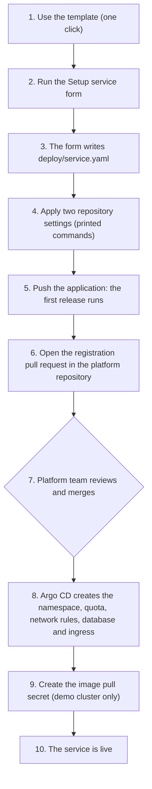
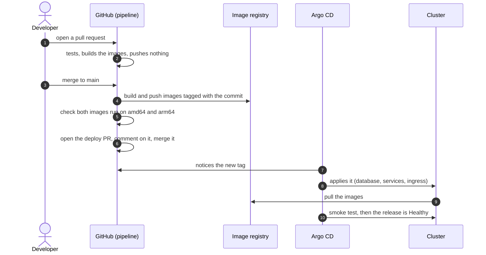
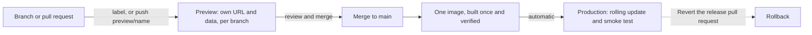

# Deploying to Kubernetes without learning Kubernetes

A walkthrough of the design: what we assumed, how it works today, where it should end up, what we gave up
on the way, and what to improve next.

Tags used below: **Works today** (built and run), **Planned** (designed, not built), **To explore** (needs a
test before we commit).

---

## 1. The idea

A team that has never used Kubernetes has to run its application on it. The goal is that the team never has to
learn it to do so. The design has four parts:

- **One small file.** The team owns `deploy/service.yaml` in its own repository: a name, an image, a port, a URL
  path and a health check. Nothing else. The team does not write it from scratch: the setup form in the template
  creates it from a few answers, and the team edits it later when something changes.
- **A pipeline that checks before it ships.** It tests the code, builds the image and confirms the image
  was built for both common processor types.
- **A pull request is the release.** Every release is a change to the image tag in that file, so it can be
  read, reverted and traced.
- **The platform owns the rest.** A chart maintained by the platform turns the file into everything
  Kubernetes needs, and Argo CD applies it. Quotas, network rules and the non-root rule belong to the
  platform and the team cannot change them. A team can set replicas and resources, within the platform's caps.

Three repositories take part:

| Repository | Holds | Owner |
|---|---|---|
| Service repository | The code, the Dockerfile, `deploy/service.yaml`, the pipeline | The team |
| Platform repository | The cluster definition, Argo CD, the chart, the list of registered services | The platform team |
| Template repository | A starting point for a new service | The platform team |

---

## 2. Assumptions

| # | Assumption | If it is wrong |
|---|---|---|
| 1 | Kubernetes is required. The brief says so | A managed platform (PaaS) may suit a team new to Kubernetes better. The file the team owns would survive the move |
| 2 | Everything that defines the platform and the services lives in Git: the cluster, Argo CD, the chart, the list of services, each service's file, even the pipeline. Changes are pull requests; screens such as Argo CD only show state. This is why we chose Argo CD, and developers generally prefer reviewable, revertable infrastructure as code to clicking through a console | A graphical console that changes things directly would be faster to start and would leave no record, no review and no easy revert. `alternatives.md` compares the portal options |
| 3 | GitHub hosts the code and runs the pipeline, and images go to GitHub's registry | The workflow files change; the model (pipeline builds, a pull request releases, Git is the source of truth) does not |
| 4 | A service is a web application with a Dockerfile, one HTTP port and a health URL, and may use Postgres. Here the database runs in the cluster, as the sample does; in production it would be a managed database, because a database in the cluster needs backups, upgrades and storage care | Workers, scheduled jobs and other shapes need more than the file offers today |
| 5 | The application creates its own database schema and starting data when it starts. The sample needs none | With several copies running, two can try to migrate at once. A rollback must also work with the newer schema |
| 6 | Developers use GitHub and a browser. They do not use `kubectl` | Diagnosis would need Kubernetes knowledge |
| 7 | One team starts, and a platform team exists to own the chart and answer questions | Without an owner the chart goes stale |
| 8 | A local kind cluster stands in for a managed cloud cluster | Load balancers, DNS, certificates and cloud permissions do not exist locally, so those parts are described, not shown |
| 9 | Platform and product teams have separate concerns. Product teams own what runs (the code and the file); the platform owns how it runs (the chart, the guardrails, the cluster). The contract between them stays stable, so the platform can improve in steps | Teams would feel every platform change, and would need to know how the platform works |
| 10 | Security and robustness come after the first deploy, on top of a baseline that is there from the start: non-root containers, resource limits, default-deny network rules, no real secrets in Git | The baseline is the part to review first |

---

## 3. How it works today

**Status: Works today.** Both journeys ran end to end: creating `hello-service` from the template, from the setup form to a live URL, and releasing a change in the sample service.

### 3.1 The file the team owns

A new service gets this file from the setup form (section 3.2), filled in from five answers. After that the team
edits it in a pull request when something changes: a port, an environment variable, a second component. It looks
like this:

```yaml
name: testkube-sample
host: testkube-sample.localhost
components:
  api: {image: ghcr.io/org/api, tag: <set by the pipeline>, port: 8080, path: /api}
  web: {image: ghcr.io/org/web, tag: <set by the pipeline>, port: 4173, path: /}
database: {enabled: true}
smoke:
  - {component: api, path: /hello-pg, contains: "hello world"}
```

From this the platform creates the namespace, the resource limits, the network rules, the deployments, the
services, the ingress, the database, a protection against taking all copies down during maintenance, and
a smoke test that runs after each release. A schema rejects anything outside the contract, such as an
unknown field or a `latest` tag.

### 3.2 Starting a new service



Steps 1, 2, 4, 5, 6 and 9 are done by a person. The platform repository takes part once: the registration pull
request, which adds the service to the list. Merging it is what makes Argo CD create the service's namespace.

- **Step 1:** create the repository from the template (one click).
- **Steps 2 and 3:** run the **Setup service** form in the Actions tab: name, port, path, health check, database yes
  or no. It checks the values and writes `deploy/service.yaml`.
- **Step 4:** apply the repository settings the form prints: two commands, once, so the pipeline may open and merge
  its release pull request. The form cannot do this itself, because it has no right to change repository settings.
- **Step 5:** push the application and its Dockerfile.
- **Steps 6 to 9:** register the service with the platform, after the first release: open a pull request that
  adds one entry to the platform repository's list of services (the form prints the entry). Today a person
  reviews and merges it, because the list is where capacity, ownership and naming are decided. In production,
  checks replace the person (section 4.1). On the demo cluster the new namespace also needs its image pull
  secret, created by hand with one command (see the runbook); a real cluster replaces it with node permissions
  or a replicated secret.

### 3.3 Releasing a change



The developer does two things: open the pull request and merge it. Everything after the merge is automatic.
The deploy pull request carries a comment with the previous tag, the new tag and how to roll back.

### 3.4 When something goes wrong

The developer starts in GitHub and ends in the Argo CD screen, not in a terminal:

- A red pipeline run names the failing step: tests, build or image check.
- A release that does not become Healthy shows the failing item in Argo CD. Clicking it opens its logs and events.
- The smoke test names the request that failed.
- **To roll back**, click Revert on the deploy pull request and merge the revert.

---

## 4. The end state in production

**Status: Planned**, with preview environments **To explore**.

### 4.1 Creating a service

The journey of section 3.2, with nobody in the way. One request (a form)
makes automation, using a GitHub App, create the repository from the template, apply its settings and open the
registration pull request. The developer pushes the application and the first release runs. Automated checks
then approve and merge the registration pull request: the name is free and allowed, the repository exists and
came from the template, the service file passes the platform schema, and the team is within its limits. If a
check fails, the pull request stays open for a person. The platform team owns these rules, not each approval,
and engineers create services on their own. Argo CD then creates the namespace and the service's cloud role. The
nodes read the registry with their cloud role, so there is no pull secret. A release never needs a platform pull
request after that.

### 4.2 Releasing a change



Each environment answers a different question:

| Environment | Question | How it behaves |
|---|---|---|
| **Preview** | Does this change work? | One per branch. Label a pull request `preview`, or push a branch named `preview/<name>`, and the platform creates a namespace with its own URL and a database filled with sample data. Closing the pull request or deleting the branch removes it. It never receives production secrets, and only branches of the same repository qualify |
| **Production** | Real users | Reached directly after the merge by the same pipeline: a rolling update (the old copies keep serving until the new ones are ready), then a smoke test. Rolling back is a revert |

**Why no staging.** A staging answers "is the merged result safe?". In this system the preview answers "does
this change work?" before the merge, a rolling update keeps the old version serving if the new one does not
start, a smoke test flags a bad release, and a revert is one click. For one team and a three-tier application,
a second environment would cost more (data, configuration that drifts, a promotion step) than it protects.

**When a staging becomes worth it.** For database migrations that must be rehearsed on realistic data, for many
services that depend on each other, or when a sign-off before production is required. It would be a shared
namespace first, then a cluster of its own.

**Canaries matter more without a staging.** A canary sends a small share of traffic to the new version and
aborts on errors. It answers the same question as a staging, inside production instead of before it. It needs
real traffic and metrics for each version, which this system does not have yet, so it is the next investment
once they exist.

**What changes for the developer.** Label the pull request to get a URL to share. The pull request review before the merge is the approval; after it, the release happens by itself.

**Where it runs.** Previews are namespaces in a non-production cluster, next to production workloads in the same or a separate cluster depending on the organization.

---

## 5. Trade-offs accepted

| Area | What we chose | What it costs |
|---|---|---|
| **Interface** | No portal. Developers use GitHub, one setup form and the Argo CD screen | Two tools to learn. Argo CD speaks in pods and other Kubernetes terms. Developers only have an administrator login for now, not a read-only one |
| **Usability** | A release is a pull request. Argo CD checks Git on a schedule, so a release waits to be noticed | A short delay on every release. Creating a service has two manual steps: the repository settings, and the registration pull request |
| | The file is deliberately small | Anything outside it (a scheduled job, a second port) means asking the platform team, which makes the team a bottleneck |
| **Security** | The demo copies a personal GitHub token into the cluster, and the database password is a demo value in the chart | Far more access than Argo CD needs, and a password that is not a secret. Fine on a local cluster, not anywhere else |
| | Releases merge automatically after an image check, with no human review | The check proves both images exist for both processor types. It does not prove the change is good. With review rules on `main`, the merge becomes a one-click approval |
| | No vulnerability scanning, no image signing, no database backups | Known gaps, listed below. Losing the cluster loses the data |
| | All services share one Argo CD project | Nothing stops one service from targeting another's namespace. The service list is the only control |
| | Anyone with write access can change the pipeline on a branch and run it | The check that only `main` may deploy lives in the same file it protects. A protected deployment environment and rules on the pipeline files close this |
| **Robustness** | One environment today. The target is previews plus production, with no staging (section 4.2) | Until previews exist, there is no place to try a release before users see it |
| | Removing a service from the list deletes its namespace and its data | Right for a preview, dangerous for production data. A production setup keeps the volumes unless the deletion is explicit |
| **Maintenance** | Each service repository holds its own copy of the pipeline | A fix must be applied to every service. Copies drift |
| | The chart follows the `main` branch | A platform change reaches every service at once, including a change that rejects a team's file |
| | We carry a patched copy of the sample application (its API address was hardcoded to `localhost`, which cannot work behind an ingress) | The real fix belongs upstream. Other findings go back to the app team: a hardcoded database password and no health endpoint |
| **Scope** | A local cluster instead of a cloud one | No cloud permissions, DNS or certificates. Not verified: that this cluster enforces network rules. Rollback, self-healing and a failed release are designed and documented, not demonstrated. Previews are described one service at a time; testing several services together is an open question |

---

## 6. Improvements, in order

### Small and soon

- **Read-only access to Argo CD for developers**, so they can look but not change.
- **A webhook from GitHub to Argo CD**, so a release is noticed at once.
- **Alerts** when a release fails to sync or stays unhealthy.
- **A check of `deploy/service.yaml` in each service's pull request**, using the platform schema.
- **Pin the chart version per service**, so a platform change reaches services one at a time, and **one Argo CD
  project per team**, so a service can only touch its own namespace.

### Next

- **Preview environments**, tested first on the local cluster, then in a shared non-production cluster.
- **A secret store** (AWS Secrets Manager or OpenBao) with External Secrets, so no secret lives in Git or in a
  script.
- **A protected deployment environment and rules on the pipeline files**, so the deploy step cannot be edited from a branch.
- **A GitHub App instead of a personal token**, with the narrowest rights each job needs.
- **One cloud permission role per service**, generated from the same file, so a team never writes a policy.
- **Admission policies** (Kyverno): forbid `latest`, require limits, allow only approved registries.
- **Image scanning and signing**, with signatures checked at admission.

### Later

- **One shared pipeline workflow** that each service calls, so there is no copy to drift.
- **Self-service repository creation and registration, with automated checks.** With a GitHub App and an organization, one form creates the repository, applies its settings and opens the registration pull request, and checks written by the platform team merge it. A person is needed only when a check fails. This needs an organization, which a personal account does not offer.
- **A shared staging**, only if the risk grows, and a staging cluster of its own to rehearse platform upgrades.
- **Canary releases**, once metrics exist. They matter more without a staging.
- **Image Updater or Kargo**, once more than one environment needs promoting.
- **A database operator or a managed database**, with backups.
